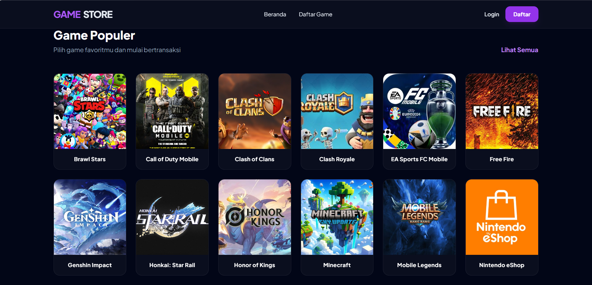
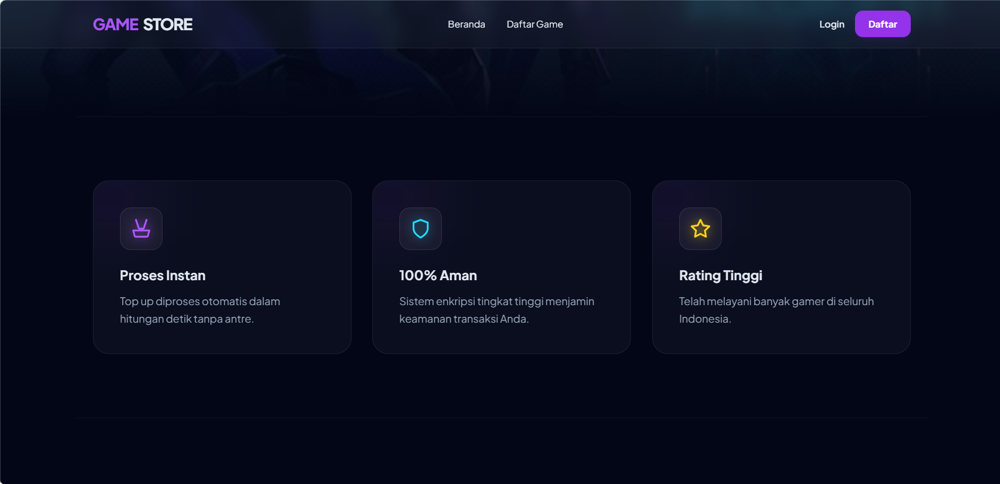
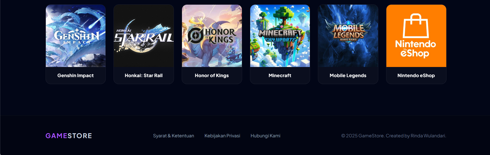

# 🎮 Website Top Up Game

Website Top Up Game adalah aplikasi berbasis web yang dikembangkan untuk memudahkan pengguna menjelajahi katalog game, memilih item game, melakukan pemesanan, serta memantau status transaksi. Aplikasi ini juga dilengkapi dengan halaman admin untuk mengelola data game, item, pengguna, dan pesanan.

Proyek ini dikembangkan sebagai bagian dari perkuliahan sekaligus portofolio untuk menerapkan keterampilan pengembangan web, pengelolaan basis data, autentikasi pengguna, dan pengolahan transaksi.

## ✨ Fitur Utama

### 👤 Fitur Pengguna

- **Registrasi dan Login** — Membuat akun dan mengakses aplikasi.
- **Katalog Game** — Menjelajahi daftar game yang tersedia.
- **Detail Game** — Melihat informasi game dan item yang ditawarkan.
- **Keranjang Belanja** — Mengelola item sebelum melakukan pemesanan.
- **Checkout** — Melakukan proses pemesanan item game.
- **Pelacakan Pesanan** — Memantau perkembangan status pesanan.
- **Riwayat Transaksi** — Melihat daftar pesanan sebelumnya.
- **Profil Pengguna** — Mengelola informasi akun.
- **Informasi Layanan** — Mengakses halaman kontak, kebijakan privasi, serta syarat dan ketentuan.

### 🛠️ Fitur Admin

- **Dashboard Admin** — Menampilkan ringkasan dan akses pengelolaan aplikasi.
- **Manajemen Game** — Mengelola informasi dan data game.
- **Manajemen Item** — Mengelola produk atau item game.
- **Manajemen Pengguna** — Mengelola data pengguna.
- **Pengelolaan Pesanan** — Mendukung administrasi pesanan dan pembaruan status transaksi.

## 🧰 Teknologi yang Digunakan

| Teknologi | Kegunaan |
|---|---|
| PHP | Mengembangkan logika aplikasi sisi server |
| MySQL | Menyimpan dan mengelola data aplikasi |
| HTML5 | Menyusun struktur halaman web |
| CSS3 | Mengatur tampilan dan tata letak |
| JavaScript | Mendukung interaksi pada halaman web |
| XAMPP / Laragon | Menjalankan lingkungan pengembangan lokal |
| Git & GitHub | Mengelola versi dan menyimpan repositori kode |

## 📸 Screenshot Aplikasi

### Halaman Utama — Bagian 1



### Halaman Utama — Bagian 2



### Halaman Utama — Bagian 3


### Halaman Utama — Bagian 4



## ⚙️ Persyaratan Sistem

Sebelum menjalankan aplikasi, pastikan perangkat memiliki:

- PHP yang kompatibel dengan kode proyek.
- MySQL atau MariaDB.
- XAMPP, Laragon, atau lingkungan server lokal sejenis.
- Browser web modern.
- Git (opsional, untuk mengkloning repositori).

## 🚀 Instalasi dan Menjalankan Aplikasi

### 1. Clone Repositori

Jalankan perintah berikut pada terminal:

```bash
git clone https://github.com/rinda6198/uas-rinda-top-up-game.git
```

### 2. Tempatkan Proyek di Folder Server Lokal

Jika menggunakan XAMPP, letakkan folder proyek di:

```text
C:\xampp\htdocs\uas-rinda-top-up-game
```

Jika menggunakan Laragon, letakkan folder proyek di:

```text
C:\laragon\www\uas-rinda-top-up-game
```

Sesuaikan lokasi folder dengan lingkungan pengembangan yang digunakan.

### 3. Jalankan Web Server dan Database

Buka XAMPP Control Panel atau Laragon, kemudian aktifkan layanan web server dan MySQL/MariaDB.

### 4. Siapkan Database

1. Buka phpMyAdmin melalui [http://localhost/phpmyadmin](http://localhost/phpmyadmin).
2. Buat database baru sesuai dengan konfigurasi aplikasi.
3. Impor file database berformat `.sql` jika tersedia.
4. Pastikan struktur tabel sesuai dengan kebutuhan aplikasi.

**Catatan:** Jika file database belum tersedia di repositori, database perlu diekspor dari lingkungan pengembangan atau disiapkan sesuai struktur yang digunakan oleh aplikasi.

### 5. Konfigurasi Database

Buka file konfigurasi database yang digunakan aplikasi, yaitu `uash/config.php` pada struktur repositori saat ini.

Sesuaikan host, username, password, dan nama database dengan konfigurasi lokal. Contoh konfigurasi umum:

```php
$host = "localhost";
$user = "root";
$pass = "";
$db   = "nama_database";
```

Contoh di atas hanya ilustrasi. Sesuaikan dengan nama variabel dan struktur konfigurasi pada file proyek yang sebenarnya.

**Keamanan:** Jangan menyimpan password produksi, kredensial sensitif, atau informasi rahasia lainnya di repositori publik.

### 6. Jalankan Aplikasi

Jika folder aplikasi berada di dalam `uash/`, buka alamat berikut melalui browser:

```text
http://localhost/uas-rinda-top-up-game/uash/
```

Jika nama folder atau lokasi `index.php` berbeda, sesuaikan URL dengan struktur proyek yang digunakan.

## 📁 Struktur Repositori

Gambaran struktur repositori:

```text
uas-rinda-top-up-game/
├── .gitignore
├── README.md
├── screenshots/
│   ├── home1.png
│   ├── home2.png
│   ├── home3.png
│   └── home4.png
└── uash/
    ├── index.php
    ├── login.php
    ├── register.php
    ├── detail-game.php
    ├── keranjang.php
    ├── checkout.php
    ├── lacak.php
    ├── riwayat.php
    ├── profile.php
    ├── config.php
    ├── admin-dashboard.php
    ├── admin-games.php
    ├── admin-items.php
    ├── admin-users.php
    ├── uploads/
    │   ├── games/
    │   └── items/
    └── ...
```

*Catatan: Struktur di atas merupakan gambaran umum. Nama file dan folder dapat berbeda mengikuti implementasi aktual proyek.*

## 🎯 Tujuan Pengembangan

Pengembangan aplikasi ini bertujuan untuk menerapkan konsep pengembangan aplikasi web, integrasi PHP dengan MySQL, autentikasi pengguna, pengolahan transaksi, serta pengelolaan data melalui antarmuka admin.

Melalui proyek ini, pengembang juga memperoleh pengalaman dalam membangun aplikasi yang mengintegrasikan antarmuka pengguna, logika aplikasi, dan pengelolaan basis data.

## 👩‍💻 Pengembang

**Rinda Wulandari**

Mahasiswa D3 Manajemen Informatika  
Politeknik Negeri Sriwijaya

- GitHub: [@rinda6198](https://github.com/rinda6198)
- Repository: [uas-rinda-top-up-game](https://github.com/rinda6198/uas-rinda-top-up-game)

---

Dikembangkan sebagai proyek perkuliahan dan portofolio pengembangan web.
