# Website Top Up Game

Website Top Up Game adalah aplikasi berbasis web yang dikembangkan untuk memudahkan pengguna menjelajahi katalog game, memilih item game, melakukan pemesanan, serta memantau status pesanan. Aplikasi ini juga menyediakan halaman admin untuk mengelola data game, item game, pengguna, dan pesanan.

Proyek ini dikembangkan sebagai bagian dari perkuliahan dan portofolio untuk menerapkan keterampilan pengembangan web serta pengelolaan basis data.

## Fitur Utama

### Fitur Pengguna

- **Registrasi Akun** — Menyediakan halaman pendaftaran akun baru.
- **Login** — Memungkinkan pengguna masuk ke aplikasi menggunakan akun yang terdaftar.
- **Beranda Pengguna** — Menampilkan halaman utama dan pilihan game yang tersedia.
- **Detail Game** — Menampilkan informasi game dan item yang ditawarkan.
- **Keranjang Belanja** — Menampilkan item yang dipilih sebelum melanjutkan pemesanan.
- **Pelacakan Pesanan** — Menampilkan informasi status pesanan pengguna.
- **Riwayat Pesanan** — Menampilkan daftar pesanan yang pernah dilakukan.

### Fitur Admin

- **Pesanan Masuk** — Menampilkan pesanan pengguna untuk dikelola oleh admin.
- **Manajemen Game** — Menyediakan halaman pengelolaan data game.
- **Manajemen Item Game** — Menyediakan halaman pengelolaan item game.
- **Manajemen Pengguna** — Menyediakan halaman pengelolaan data pengguna.

## Teknologi yang Digunakan

| Teknologi | Kegunaan |
|---|---|
| PHP | Mengembangkan logika aplikasi sisi server |
| MySQL | Menyimpan dan mengelola data aplikasi |
| HTML5 | Menyusun struktur halaman web |
| CSS3 | Mengatur tampilan dan tata letak |
| JavaScript | Mendukung interaksi pada halaman web |
| XAMPP / Laragon | Menjalankan aplikasi di lingkungan lokal |
| Git & GitHub | Mengelola versi dan menyimpan repositori kode |

## Screenshot Aplikasi


**1. Beranda Guest**


**2. Registrasi Akun**

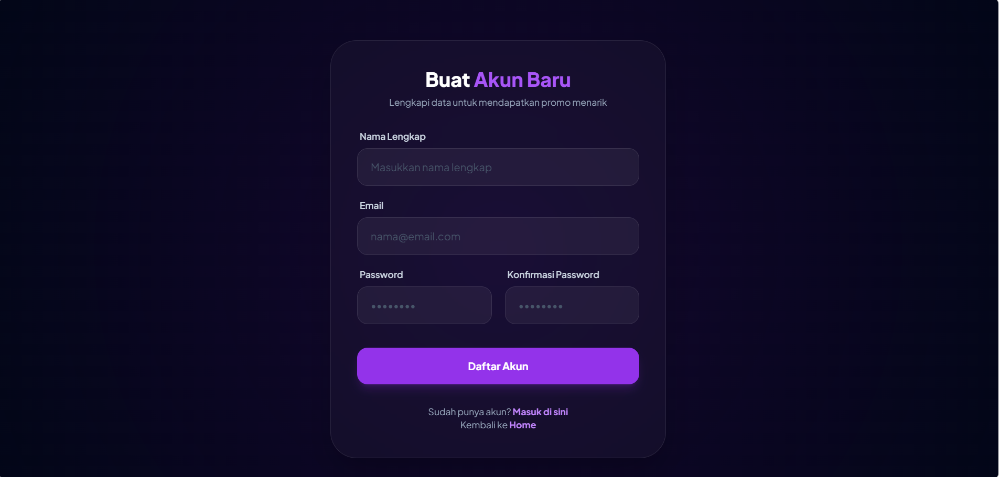

**3. Login**

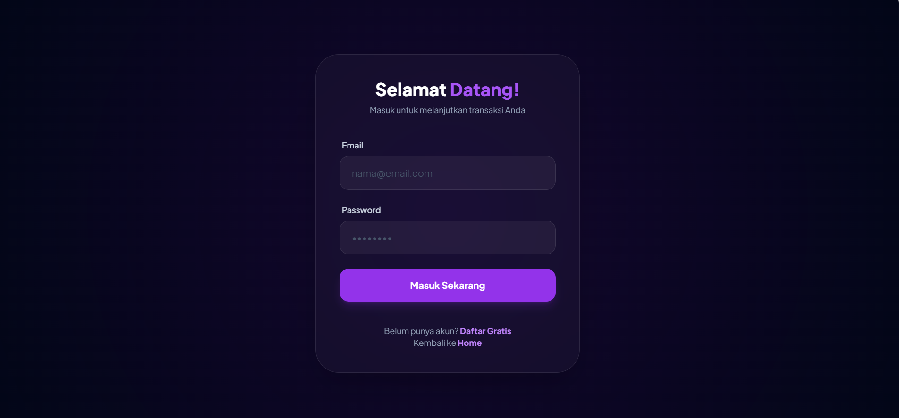

### Halaman Pengguna

**1. Beranda Pengguna**

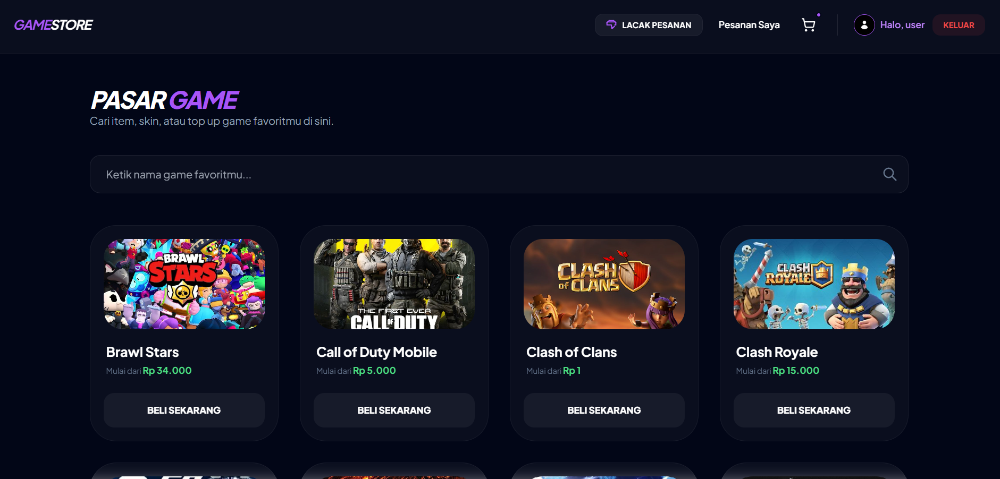

**2. Detail Game**

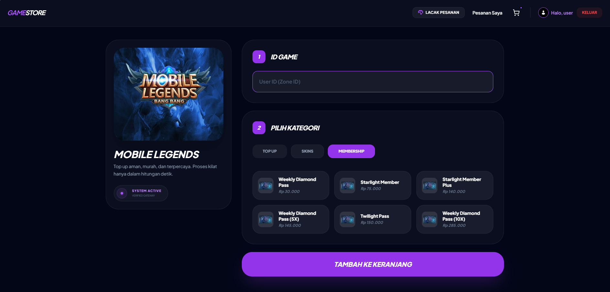

**3. Keranjang Belanja**

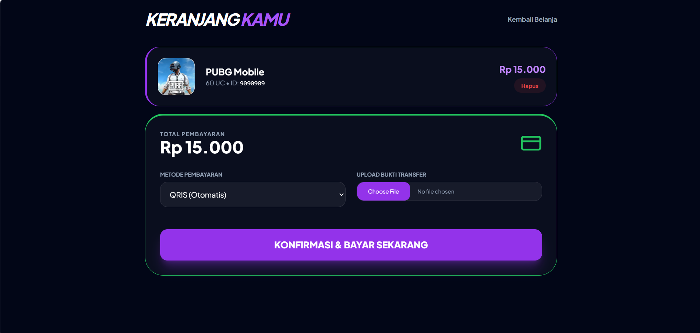

**4. Riwayat Pesanan**

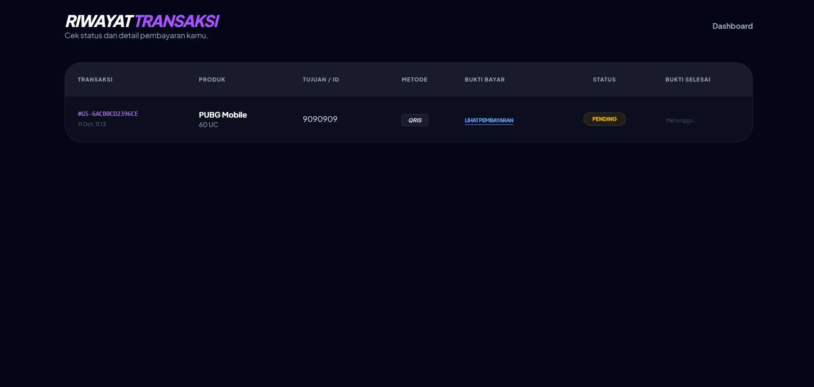

**5. Pelacakan Pesanan**

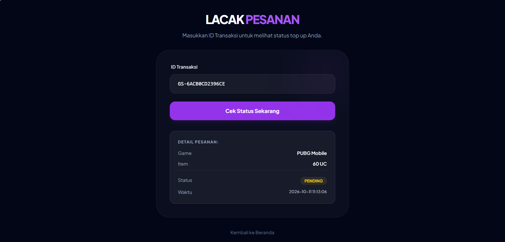


### Halaman Admin

**1. Pesanan Masuk**

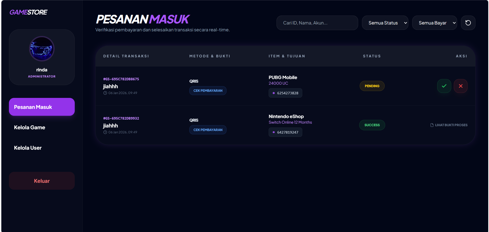

**2. Manajemen Game**

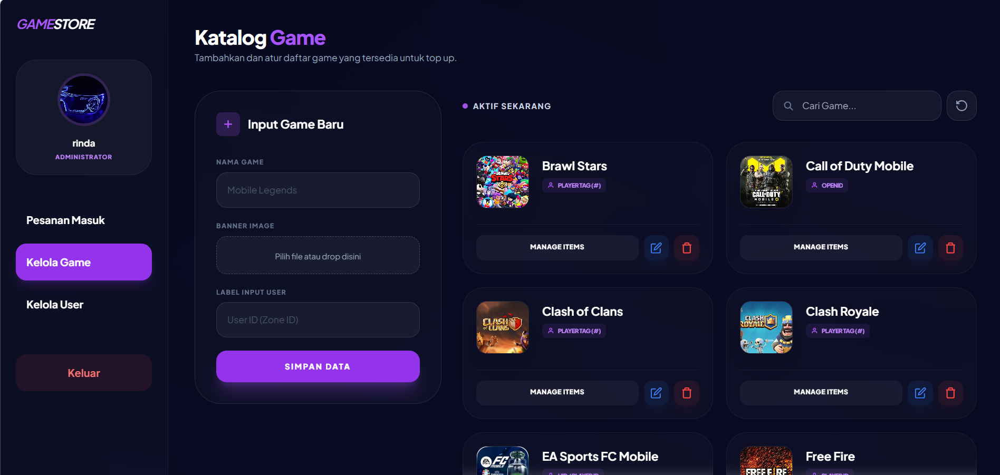

**3. Manajemen Item Game**

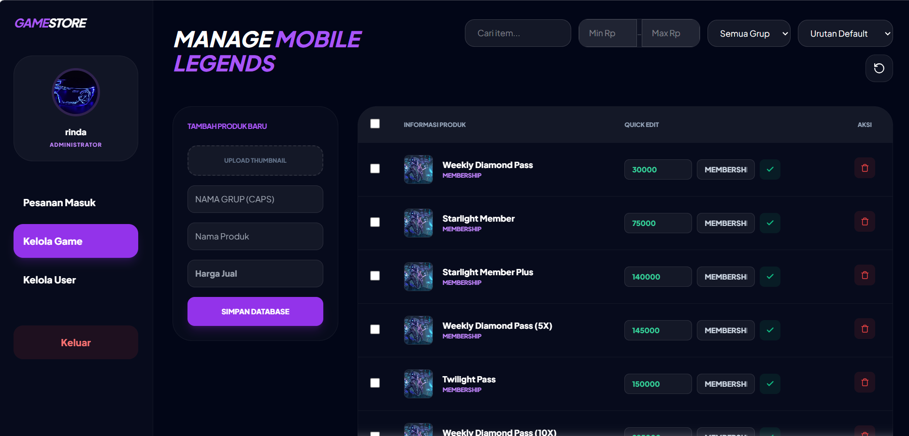

**4. Manajemen Pengguna**

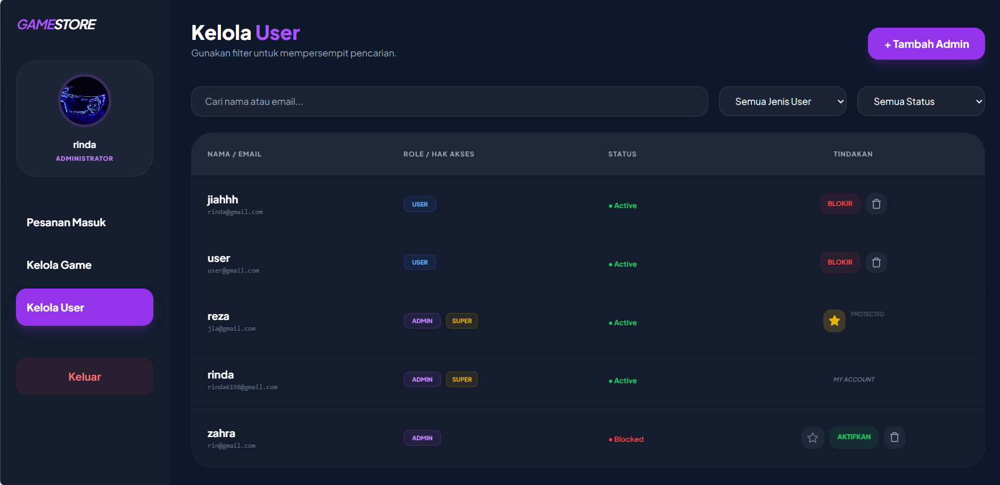


## Persyaratan Sistem

Sebelum menjalankan aplikasi, siapkan:

- PHP yang kompatibel dengan kode proyek.
- MySQL atau MariaDB.
- XAMPP, Laragon, atau web server lokal sejenis.
- Browser web modern.
- Git (opsional, untuk mengkloning repositori).

## Instalasi dan Menjalankan Aplikasi

### 1. Clone Repositori

Jalankan perintah berikut pada terminal:

```bash
git clone https://github.com/rinda6198/uas-rinda-top-up-game.git
```

### 2. Tempatkan Proyek

Jika menggunakan XAMPP, letakkan folder proyek di:

```text
C:\xampp\htdocs\uas-rinda-top-up-game
```

Jika menggunakan Laragon, letakkan folder proyek di:

```text
C:\laragon\www\uas-rinda-top-up-game
```

### 3. Jalankan Web Server

Buka XAMPP Control Panel atau Laragon, kemudian aktifkan web server dan MySQL.

### 4. Siapkan Database

1. Buka phpMyAdmin melalui `http://localhost/phpmyadmin`.
2. Buat database sesuai konfigurasi yang digunakan aplikasi.
3. Impor file database `.sql` jika tersedia.
4. Pastikan struktur tabel sesuai dengan kebutuhan aplikasi.

**Catatan:** Jika file database belum tersedia di repositori, siapkan ekspor database dari lingkungan pengembangan atau buat struktur database sesuai implementasi aplikasi.

### 5. Konfigurasi Database

Periksa file konfigurasi database di folder `uash/`. Jika aplikasi menggunakan `uash/config.php`, sesuaikan konfigurasi koneksi dengan database lokal.

Contoh konfigurasi umum:

```php
$host = "localhost";
$user = "root";
$pass = "";
$db   = "nama_database";
```

Kode di atas hanya contoh. Sesuaikan nama variabel dan konfigurasi dengan file proyek yang sebenarnya.

Jangan menyimpan kredensial produksi atau informasi rahasia di repositori publik.

### 6. Jalankan Aplikasi

Jika file utama aplikasi berada di dalam folder `uash/`, coba akses alamat berikut:

```text
http://localhost/uas-rinda-top-up-game/uash/
```

Sesuaikan alamat tersebut jika struktur folder atau lokasi file utama berbeda.

## Struktur Repositori

```text
uas-rinda-top-up-game/
├── README.md
├── screenshots/
│   ├── home1.png
│   ├── home2.png
│   ├── home3.png
│   ├── home4.png
│   ├── berandauser.png
│   ├── detailgameuser.png
│   ├── halamanlogin.png
│   ├── keranjanguser.png
│   ├── manajemengameolehadmin.png
│   ├── manajemenitemgameolehadmin.png
│   ├── manajemenuserolehadmiin.png
│   ├── pacakpesananuser.png
│   ├── pesananmasukadmin.png
│   ├── registerakunuser.png
│   └── riwayatpesananuser.png
└── uash/
    └── ... (file aplikasi)
```

## Tujuan Pengembangan

Proyek ini bertujuan untuk menerapkan konsep pengembangan aplikasi web, integrasi PHP dengan MySQL, pengelolaan data, serta pemisahan fitur pengguna dan admin dalam sebuah website Top Up Game.

## Pengembang

**Rinda Wulandari**

D3 Manajemen Informatika  
Politeknik Negeri Sriwijaya

- GitHub: [@rinda6198](https://github.com/rinda6198)
- Repositori: [uas-rinda-top-up-game](https://github.com/rinda6198/uas-rinda-top-up-game)

---

*Dikembangkan sebagai proyek perkuliahan dan portofolio pengembangan web.*
